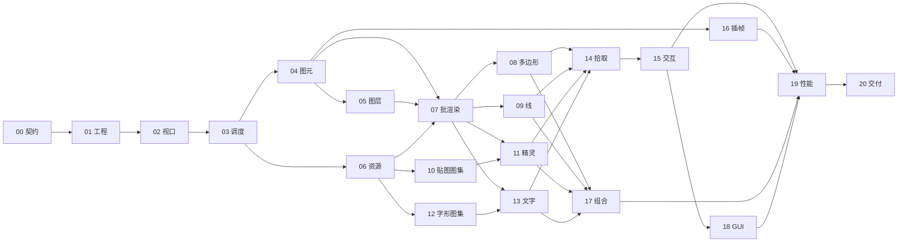

# 重构任务入口

本目录是 `refactor.md` 的分批实现依据. 本轮已完成 00-20 的框架实现, 新业务入口为 [core/index.ts](../core/index.ts), 使用方法见 [README](../README.md), 当前实现链路与验证范围见 [源码导读](./documents/README.md) 和 [独立调试指南](./documents/04-debug.md).

类型草案中的辅助文件按实际职责合并, 公共契约以 `core/contracts/index.ts` 为准. 各模块使用独立测试入口 `core/debug/units/<name>.ts`, 独立 HTML 位于 `multi-pages/debug/refactor`, 索引为 `multi-pages/debug/index.html`. 页面打开即执行本模块的最小案例, 不再统一加载模拟设备场景. 当前源码导读, API 到 Three.js 的链路及调试指南见 [documents](./documents/README.md). 2D 首期范围与下面的已确认决策保持一致.

## 已确认的决策

- 首期实现 2D, 预留高度, 相机和渲染后端扩展点.
- 默认按可见像素拾取, 支持管线容差, 业务优先级和部件所属设备.
- 使用显式装饰器元数据自动生成每实例 lil-gui 面板.
- 用对象组合组织设备, 对业务隐藏 GPU 批次, 槽位和上传细节.

需要修正的前提: OpenLayers 本身支持 WebGL, 老模板的 `templates/inMap/layers/bakeMapLayer.js` 已在使用. 新框架解决的是当前动态设备更新, 渲染和拾取路径的限制. Three.js 不会自动消除 CPU 更新, 文本布局和 GPU 读回成本. 参考 [OpenLayers 官方示例](https://openlayers.org/en/latest/examples/webgl-vector-layer.html).

## 执行方式

1. 先阅读 [00 公共契约](./00-contracts.md), 后续模块以它为接口依据.
2. 每次指定一个或几个任务文件执行, 检查其前置任务已完成.
3. 每个任务落实实现, 独立 debug 页面和该文件中的轻量验收, 再继续依赖它的任务.
4. 接口发生必要调整时, 同步修改公共契约和受影响任务, 避免各批次各自定义同名接口.
5. 重要模块, 核心流程和难懂处理添加中文注释. 中文内容使用英文标点. 优先可读性和可拓展性, 不做重型测试体系.

保留已有用户改动. 实现主要写入 `core`, 调试入口写入 `multi-pages/debug`. `templates` 只作为需求参照, `source` 在此轮分批实现中不接入. 优先复用离线算法和资源, 不直接修改 `libs/three.js-r170` 来实现业务能力.

## 任务与依赖

编号是一条可执行的顺序, 不代表每项都依赖前一项. 表中列出必须已完成的任务.

| 编号 | 任务 | 前置 | 主要交付 |
| --- | --- | --- | --- |
| 00 | [公共契约与边界](./00-contracts.md) | 无 | 统一类型, 公开 API 和模块职责 |
| 01 | [离线工程与 debug 入口](./01-offline-debug.md) | 00 | r170 别名, 类型和多页面构建 |
| 02 | [坐标, 视口与相机](./02-viewport-coordinates.md) | 01 | 局部坐标, 缩放, 平移, 屏幕换算 |
| 03 | [帧调度与脏更新](./03-render-scheduler.md) | 02 | 更新合并, 持续动画, 状态恢复 |
| 04 | [逻辑图元与生命周期](./04-primitives.md) | 03 | 稳定 handle, 属性更新, 事件与销毁 |
| 05 | [图层与显示顺序](./05-layers-order.md) | 04 | 跨类型顺序, 显隐, 选择过滤和 LOD |
| 06 | [共享资源与释放](./06-resources.md) | 03 | 异步资源, 引用计数和所有权 |
| 07 | [自动批渲染基础](./07-batching.md) | 04, 05, 06 | 分批, 局部上传, 扩容和稳定映射 |
| 08 | [多边形](./08-polygons.md) | 07 | 外环, 孔洞, 多个独立区域和局部更新 |
| 09 | [粗线与虚线](./09-lines.md) | 07 | 屏幕/世界宽度, 路径更新和虚线 |
| 10 | [精灵贴图图集](./10-sprite-atlas.md) | 06 | 多页纹理, 透明边缘和增量加载 |
| 11 | [精灵批渲染](./11-sprites.md) | 07, 10 | 每实例贴图, 锚点, 颜色和变换 |
| 12 | [字形与字体图集](./12-font-atlas.md) | 06 | 离线字体, 中文缺字和增量 SDF 图集 |
| 13 | [文字批渲染](./13-text.md) | 07, 12 | 标签布局, 背景, 动态内容和字形合批 |
| 14 | [GPU 精准拾取](./14-gpu-picking.md) | 08, 09, 11, 13 | ID 通道, 透明掩码, 容差和优先级 |
| 15 | [交互与选择状态](./15-interaction.md) | 02, 05, 14 | 悬浮, 点击, 双击, 程序化选择 |
| 16 | [实时插帧](./16-motion.md) | 03, 04 | 时间戳, 位置/角度插值和断流处理 |
| 17 | [组合设备对象](./17-composition.md) | 08, 09, 11, 13 | 跨层部件, 设备级变换和选择归属 |
| 18 | [每实例调试 GUI](./18-debug-gui.md) | 04, 15 | 装饰器, 实例索引, 面板和生产隔离 |
| 19 | [性能观察与轻量场景](./19-performance.md) | 15, 16, 17, 18 | 可调负载, draw calls, 帧耗时和上传量 |
| 20 | [公共入口与交付检查](./20-delivery.md) | 01-19 | 模拟设备示例, API 文档和释放检查 |

07 完成后, 08/09/10/12 可以并行. 11 等待 10, 13 等待 12. 16 可以在 04 后并行. 17 与 14/15 可以并行, 不需要先接真实业务.

图展示主依赖, 精确前置以表格和各任务文件为准. 性能场景是比较与观察工具, 尚未给定客户机, 实际数量和更新频率, 不把某个固定 FPS 写成默认承诺.
