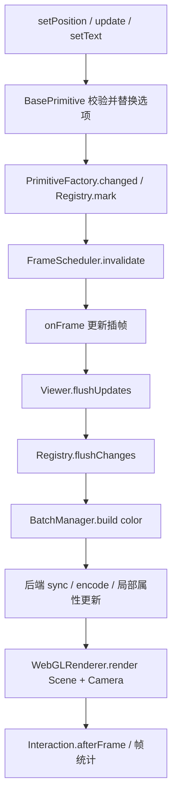

# 从用户 API 到一帧提交

## Viewer2D 是组合入口

[Viewer2D.ts](../../core/Viewer2D.ts) 的构造器创建 canvas 和 `THREE.WebGLRenderer`, 设置输出色彩空间和背景. 随后组装如下对象:

1. `Viewport2D` 维护尺寸, 中心和 scale. resize 回调调用 renderer 的 `setPixelRatio` 与 `setSize`.
2. `LayerManager`, `PrimitiveRegistry`, `ResourceStore` 保存当前 Viewer 的逻辑状态和资源索引.
3. `SpriteAtlas` 和 `GlyphAtlas(FontStore)` 提供图片或字形区域.
4. `BatchManager` 注册 Polygon, Line, Sprite, Text 四种 backend.
5. `FrameScheduler` 接收 flushUpdates/renderColor/afterRender 管线.
6. `PrimitiveFactory` 把变更通知接到 registry, prepare 和 invalidate.
7. `MotionController`, `GpuPicker`, `InteractionController` 共用上述模块, 而非各自创建 renderer 和帧循环.

构造过程中已建立的模块记录在清理栈中. 中途失败时逆序释放, 防止留下 canvas, RAF 或观察器.

## 创建图元

```ts
import { Viewer2D } from "@core/index";
const view = new Viewer2D({ container, center: [0, 0], scale: 16 });
view.layers.add({ id: "devices", order: 20 });
const body = view.primitives.addPolygon({
  id: "device/body",
  layer: "devices",
  geometry: {
    type: "Polygon",
    polygon: {
      outer: [
        [-2, -1],
        [2, -1],
        [2, 1],
        [-2, 1],
      ],
    },
  },
  fill: "#62bed5",
});
body.setPosition([10, 20]);
```

`PrimitiveFactory.create` 向 `PrimitiveRegistry.identity` 申请逻辑 ID, 插入序号, RGB24 pickId 和 generation. 构造 `PolygonPrimitive` 时复制并校验输入. 构造失败会归还身份槽位, 成功才登记到 registry.

创建后的 handle 是稳定逻辑对象. 多个 handle 可以合成同一个 Mesh, 同一个 handle 也可能拆成多个 GPU 片段. 业务不要保存 GPU 槽位作为图元身份.

Sprite/Text 创建还会进入 backend.prepare. 图片或文字没有准备好时不会伪造可绘制数据. `await handle.ready()` 等待当前准备任务, 常规业务无须随后手动重绘, 异步完成会 invalidate.

## 更新与帧管线



`BasePrimitive.update` 先生成候选选项, 校验通过才替换状态. 普通字段替换, `transform` 与 `hit` 合并子字段. 无实际变化不增加 version. 选项快照递归冻结, 外部不能绕过 API 修改状态.

脏类型包括 transform, style, geometry, resource, order 和 visibility. 例如 setPosition 标记矩阵变化, setText 标记布局变化, setImage 标记资源变化. Registry 合并同一图元的通知; 后端同时根据 version 和内容签名避免不必要上传.

`FrameScheduler.invalidate` 只排一个 RAF. `run` 先通知动画 listener, 再 flushUpdates, 再 renderColor. 动画 listener 写入的状态在同一帧消费. `acquireContinuous` 返回释放函数, 最后一个动画令牌释放且无脏状态后不再继续排帧.

`view.flush()` 对应 `scheduler.flushNow()`, 用于调试和需要立即同步的查询. 已在执行管线时避免递归提交. 普通 setter 不需要业务手动 flush.

## 坐标与相机

`LocalCoordinateAdapter` 只在业务显式调用时适配外部坐标. 例如毫米大坐标先减 origin, 除 unitsPerMeter, 再根据 axis 翻转. 图元接收的是局部米坐标.

`scale` 的单位为 CSS 像素/米. 逻辑 `[x,y]` 在 GPU 对应 `(x,height,-y)`. 相机从 +Y 俯视 XZ, `camera.up=(0,0,-1)`. `OrthographicCameraAdapter.update` 根据 CSS 宽高/scale 设置 left/right/top/bottom, 调用 `updateProjectionMatrix` 和 `updateMatrixWorld`.

`worldToScreen` 使用 `Vector3.project`, `screenToWorld` 使用 `unproject`, 均输出/输入 CSS 像素. 鼠标 client 坐标先通过 `Viewport2D.clientToScreen` 转换. 只有拾取读回等底层环节才换算到 drawing buffer 物理像素并翻转 y.

## 销毁与上下文恢复

`Viewer2D.dispose` 幂等. 先发出销毁通知并停止 GUI, interaction, picker, motion 和 scheduler, 再释放设备, 图元, 批次, 图层, 图片预加载 lease, 字形和图片图集, 资源 Store, viewport, renderer, 最后移除 canvas.

handle 销毁会从 registry 摘除, 通知 backend.remove 和依赖的交互/GUI. Scene.remove/clear 不会释放 geometry/material, 所以后端显式 dispose GPU 对象. 共享资源由 lease 控制最后释放时机.

context lost 时暂停调度并作废 pending pick. restored 时后端把属性和纹理重新标记上传, 重建拾取 target, 恢复背景和调度. 这是对同一套 CPU 状态重新提交, 不是重新创建业务设备.
