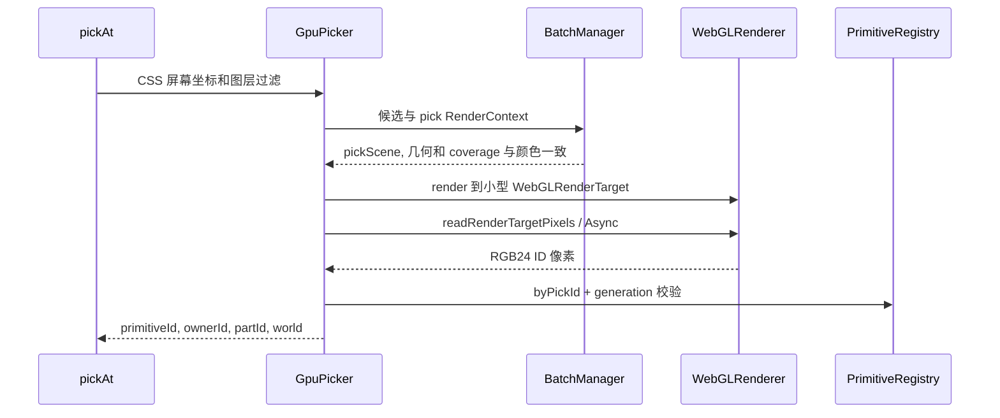

# 拾取, 交互, 插帧与组合设备

## GPU 拾取到逻辑 ID

用户可以直接调用 `view.picking.pickAt(screen, query)` 或异步版本, screen 为 CSS 像素. 查询先同步当前姿态, 再由 `BatchManager.features/bounds` 裁出查询附近候选. 包围盒只用来缩小候选集, 最后是否命中仍由 shader 的实际覆盖决定.



target 使用 RGBA8, NearestFilter, NoColorSpace, 无 MSAA 和深度. shader 输出 ID 颜色时禁用混合, 避免 ID 被色彩转换或透明混合污染. 写 ID 前检查 alphaThreshold, visible 模式共用图片透明度, SDF 字形边缘或虚线间隙, bounds 则显式覆盖矩形范围.

查询按容差创建小 target 并裁剪投影, 不是把整张画布读回 CPU. 坐标从 CSS 转为物理像素, 并处理左上原点与 WebGL 左下原点的差异.

多个像素的候选优先比较 hit.priority, 再比较到查询位置的距离, 再比较画家顺序. 图层过滤在候选阶段应用, 被排除图元不遮挡当前查询. 默认 tolerancePx=0.

异步查询保存 viewport/layer/hit revision 和 pickId generation. 删除重建, 图层变化, 相机变化或 mask 改动后, 旧结果会被丢弃. render 的 finally 立即恢复 target, scissor, clearColor 和 PBO 等状态, 不跨 await 占用颜色管线的 renderer 状态.

## 从拾取到事件

`InteractionController` 监听 canvas 指针事件. hover 只在颜色帧之后发起, 最多一个正在处理的请求, 并以 pointer/query epoch 排除过时结果. click 使用当次同步拾取, 不复用上次 hover. 平移手势后的 click 被手势状态和移动距离过滤.

默认 selectionMode=owner. 同一设备的 body 和 label 可以改变活动 primitiveId/partId, 但不会重复发送设备级 select/deselect. `onSelectionChange` 的 selectionChanged 能区分归属变化和部件变化. 未设置 ownerId 时退回图元 ID.

程序化调用:

```ts
view.interaction.select({ primitiveId: body.id });
view.interaction.select({ ownerId: "device-1", preferredPartId: "body" });
```

事件的 target 仍是实际 PrimitiveHandle. 图元销毁或图层不可用时重新验证 hover/selection, 按生命周期派发离开或取消选择. 重入的选择操作排队, 避免事件回调再触发选择破坏中间状态.

## 插帧仍走同一 setter 链路

```text
motion.bind(target, options).push(sample)
  -> MotionBinding 保存样本或 transition
  -> MotionController.setActive 获取持续帧令牌
  -> FrameScheduler.onFrame
  -> MotionBinding.advance(now)
  -> target.setPosition / setRotation
  -> 普通图元脏更新链 / EntityView 父矩阵更新
```

latest 模式从当前显示姿态过渡到最新样本. timestamped 模式用 normalizeTime 将外部时间映射到同一时钟, 缓冲样本并按 delayMs 播放. 角度使用 shortestAngleDelta, 避免从 350 度到 10 度绕远路. 距离过大或时间断层可 snap, staleAfterMs 表达断流状态.

所有绑定共用一个调度器, 不会每个设备建立 RAF. 到达终点或 pause/dispose 后离开 active 集合, 最后一个活动目标退出时释放持续帧令牌. 目标支持 onDispose 时绑定也跟随目标生命周期释放.

## EntityView 组合跨层部件

```ts
const entity = view.entities.create({ id: "device-1" });
entity.addPart("body", body).addPart("label", label);
entity.setPosition([10, 20]).setRotation(Math.PI / 2);
```

addPart 给图元写入 ownerId/partId 和父 Matrix4, 不改变图元 layer. 部件保留自己的局部位置和旋转. `BasePrimitive.getEffectiveMatrix` 计算 `parent * local`, 后端读取最终矩阵. EntityView 不创建 Three.Group, 跨层部件仍能保持全局画家顺序.

removePart 默认保留世界姿态再解除父变换, 并清除归属. 带剪切的有效矩阵不能精确表示为单一 TRS, 此时先拒绝分离, 不先修改归属再报错. 可先消除剪切, 或选择 dispose 部件. 销毁 Entity 会释放仍归属的所有部件.

## GUI 的写入路径

Viewer 仅在 `__WEBGUI_DEBUG__` 和 debug.gui 开启时动态加载 `attachDebugTools`. 后者监听 registry/entities, 将每个实例包装为 DebugProxy 并登记 DebugRegistry. DebugField 装饰器只收集显式元数据, 不依赖 TypeScript 类型反射.

DebugGUIManager 使用 lil-gui 编辑独立 model, 再经代理 setter 调用 handle.update/EntityView API. 编辑姿态时代理会暂停相应 motion binding. 更新仍走统一校验, 脏标记和渲染链, 不直接修改 aMatrix 或冻结快照.

GUI 面板只创建当前选中实例的控件, refresh 观察现有通知, 不用 lil-gui.listen 为每字段启动额外循环. Viewer 销毁会解除注册并销毁 GUI.
